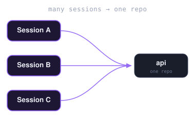
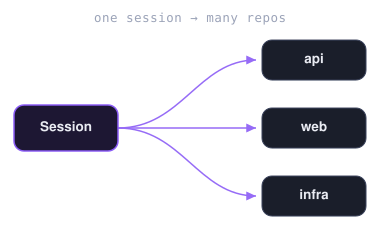
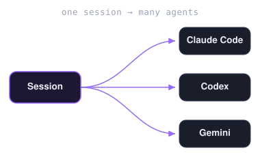

#  Klaussy

> [!IMPORTANT]
> **© 2026 Dovatech LLC. All rights reserved.** This repository hosts www.klaussy.com. Its text, images, video, and design aren't licensed for reuse, and copying them for commercial use is copyright infringement. **Klaussy Desktop** is covered by the [Sustainable Use License (SUL 1.0)](https://github.com/steph-dove/klaussy-desktop/blob/main/LICENSE), **[klaussy-agents](https://github.com/steph-dove/klaussy-agents)** is covered by the [Functional Source License (FSL-1.1-MIT)](https://github.com/steph-dove/klaussy-agents/blob/main/LICENSE), and the hosted **Klaussy Loop** and **klaussy review** services at [app.klaussy.com](https://app.klaussy.com) are covered by our [Terms of Service](https://www.klaussy.com/terms.html).

**From first prompt to merged PR, with agents that know your codebase.**
The multi-agent workspace and dev loop for professional engineers.

[](https://github.com/steph-dove/klaussy-desktop/stargazers)

*Created by an ex-GitHub, Microsoft & Twitch engineer. Trusted by engineers at Microsoft, Meta, GitHub, Twitch, Rad AI, and O'Reilly Media.*

- **Klaussy Desktop** (macOS, Windows, Linux): Run multi-repo coding sessions with any mix of AI agents (**Claude Code, Codex, Gemini, Antigravity, Copilot, Cursor, Cline, opencode, Kimi Code, Ollama, Nemesis8 Sandbox**) side by side, review PRs/MRs across **GitHub, GitLab, and Bitbucket**, and debug failing CI. Source-available under **SUL 1.0**.
- **[Klaussy Loop](https://app.klaussy.com/?app=loop)**: The cloud issue-to-PR dev loop across GitHub, GitLab, Bitbucket, and Azure DevOps: hand it an issue, get back a QA'd, green pull request on your own model key.
- **[klaussy review](https://app.klaussy.com)**: Automated inline PR/MR reviews across GitHub, GitLab, Bitbucket, and Azure DevOps using Claude, Copilot, or OpenAI on your own key (or self-hosted via the [GitHub Action](https://github.com/marketplace/actions/klaussy-review)).
- **[klaussy-agents](https://github.com/steph-dove/klaussy-agents)**: The underlying engine powering repo conventions, custom skills, multi-agent review passes, and git-level guardrails. Source-available under **FSL-1.1-MIT** (converting to MIT two years after each release ships).

### [⬇ Download Klaussy Desktop](https://www.klaussy.com/#download-btn) · [🚀 Launch Klaussy Loop & Review](https://app.klaussy.com) · [★ Star on GitHub](https://github.com/steph-dove/klaussy-desktop)

The download page auto-detects your OS and architecture and gives you the right file, or pick one yourself from the [latest release](https://github.com/steph-dove/klaussy-desktop/releases/latest).

Klaussy Desktop is source-available under the Sustainable Use License (SUL 1.0), free for personal use, development, and internal business use. You only need a commercial license to sell it or offer it as a commercial service.

---

## No server for Desktop. No markup. Use any agent.

Klaussy Desktop runs locally on your machine, and our hosted services (**Klaussy Loop** and **klaussy review**) run on your own AI provider keys with zero token markup.

- **Serverless desktop by design.** Everything in Klaussy Desktop runs on your machine. We operate no backend for Desktop, so there's no copy of your repos, prompts, or history on someone else's disk. Your code goes only to the agent provider you picked, through the CLI you already installed and trust.
- **Bring your own subscription or key.** Klaussy is not a token reseller. Desktop drives the agent CLIs you already pay for, and Klaussy Loop and klaussy review use the API key you provide at the provider's own price: no resold credits, no marked-up tokens, nothing metered on AI usage. Or pay nothing at all and point Desktop at free and local models through Ollama.
- **Your data isn't the product.** We never sell your code or use your repositories, diffs, or QA captures to train models.
- **Free for individual developers and internal teams.** Klaussy Desktop is 100% free for personal use, development, and internal business use under SUL 1.0, and `klaussy-agents` is source-available under FSL-1.1-MIT. Klaussy Loop and klaussy review both include a free tier on your own key. If your company wants a bespoke edition built around its own tooling and security rules, we're happy to talk. See [Enterprise & Partnerships](#enterprise--partnerships).

The whole thing is inspectable, runs locally, and keeps working if we disappear. That's the point.

---

## What it does

- **Any agent, your choice.** Run each session on **Claude Code, OpenAI Codex, Google Gemini, GitHub Copilot, Cursor, or Cline** — pick a global default, switch it per terminal, or run the same session in two agents side by side. PR review, implement, CI-debug, and ask all follow your selected agent + model.
- **Sessions, your way.** A session is whatever you need — one repo or many. Pick the repos it touches (including straight from your recent GitHub, GitLab, or Bitbucket repos, cloned on demand); each gets the same branch and its own worktree, with any number of agents you choose, even different ones side by side. Run several sessions at once — including more than one on the same repo — and resume any of them later with one click, every repo back with its agent conversations. Manage or delete sessions (worktrees included) from the sidebar. Columns, grid, or single-pane view; no more juggling `cd`s.
- **Repo-aware agents.** On session start, Klaussy analyzes the repo — extracting its conventions, rules, and import graph (fan-in/out, cycles, endpoint chains) — and gives your agents that context to draw on. PR review, Plan, Debug, and implement runs ground their work in how your codebase fits together instead of generic advice, and the analysis refreshes as the repo changes.
- **Auto-debug CI failures.** Klaussy connects to your PR/MR CI checks (GitHub Actions, GitLab CI/CD, Bitbucket Pipelines). When one goes red, pull the logs in with a click and your agent runs a focused debug pass — likely cause, suggested fix, applied straight to the worktree.
- **Full PR & MR review surface.** Pull in a GitHub PR, GitLab MR, or Bitbucket PR, read the diff with inline comments, run an AI review that breaks into per-finding cards — ignore, implement, or append to PR/MR.
- **Plan · Debug · Review.** A dropdown on every worktree that spawns a dedicated agent tab running Klaussy's guided **Plan** flow, a **Debug** pass, or a multi-phase PR **Review** — each on the same worktree, no context loss.
- **Agent mirroring to Discord & Slack.** Turn on notifications for a session and it mirrors into a Discord or Slack thread, streaming the agent's output as it works. Reply from your phone to answer a prompt, approve a plan, or redirect the work while you're out running errands — then come back to Klaussy and continue the same conversation, full scrollback and same worktree intact.
- **Inline AI — locally.** Tab-autocomplete as you type, powered by `qwen2.5-coder` running on your machine via Ollama. ~100ms latency. No code leaves your laptop.
- **Agentic Git Hooks.** Klaussy embeds autonomous agents directly into your local Git workflow. Built-in pre-commit and pre-push hooks automatically run local agent checks over staged diffs, catching correctness landmines, silent failures, leaked secrets, and debug leftovers. By taking care of commit, code, and planning guardrails, Klaussy ensures your branch stays clean, safe, and stable before anything is pushed.
- **Built-in editor.** Monaco editor with LSP diagnostics. Open any file, edit, commit straight from the diff panel. AI-generated commit messages optional.

## How sessions work

Stack several on one repo, fan one across many repos, or mix agents inside a single session.

|  |  |  |
|:--:|:--:|:--:|
| **Many sessions, one repo.** Parallel sessions on the same repo — a feature here, a hotfix there. | **One session, many repos.** Every repo a change touches, same branch everywhere, side by side. | **One session, many agents.** Mix Claude Code, Codex, Gemini, Copilot, Cursor, and Cline in a single session. |

## Requirements

Klaussy runs on **macOS 12+** (Apple Silicon or Intel), **Windows 10/11**, or **Ubuntu 22.04+** (other modern Linux distros generally work).

You'll also need **at least one supported agent CLI or IDE extension** — [Claude Code](https://claude.ai/code), [OpenAI Codex](https://github.com/openai/codex), [Google Gemini](https://github.com/google-gemini/gemini-cli), [GitHub Copilot](https://github.com/github/copilot-cli), [Cursor](https://cursor.com), or [Cline](https://github.com/cline/cline) — and authenticated credentials for your Git forge (the [GitHub CLI (`gh`)](https://cli.github.com), [GitLab CLI (`glab`)](https://gitlab.com/gitlab-org/cli), or Bitbucket account credentials). Ollama is optional and only needed for local inline autocomplete.

## Install

Easiest: open **[klaussy.com](https://www.klaussy.com/#download-btn)** — it detects your OS and offers the right file directly.

Or grab the matching file from the [latest release](https://github.com/steph-dove/klaussy-desktop/releases/latest) using the picker below.

<details>
<summary><b>macOS</b> — pick by chip type</summary>

Open the Apple menu → **About This Mac** and look at the **Chip** (or **Processor**) row.

| Your Mac says | Download |
| --- | --- |
| Apple M1 / M2 / M3 / M4 (Apple Silicon) | `Klaussy-<ver>-macOS-arm64.dmg` |
| Intel | `Klaussy-<ver>-macOS-x64.dmg` |

Open the `.dmg`, drag **Klaussy** into **Applications**, done. Klaussy is signed and notarized — no quarantine workaround needed.

</details>

<details>
<summary><b>Windows</b> — installer or portable</summary>

| Want | Download |
| --- | --- |
| Standard install on Windows 10/11 | `Klaussy-<ver>-Windows-Setup.exe` |
| Portable (no install) | `Klaussy-<ver>-Windows-Portable.exe` |

Signed with an SSL.com EV certificate — Windows SmartScreen should pass cleanly.

</details>

<details>
<summary><b>Linux</b> — by distro</summary>

| Distro | Download |
| --- | --- |
| Ubuntu, Debian, Mint, Pop!_OS | `Klaussy-<ver>-Linux-Debian-Ubuntu.deb` |
| Fedora, Arch, openSUSE, anything else | `Klaussy-<ver>-Linux.AppImage` |

`.deb`: `sudo dpkg -i Klaussy-<ver>-Linux-Debian-Ubuntu.deb`

AppImage: `chmod +x Klaussy-<ver>-Linux.AppImage && ./Klaussy-<ver>-Linux.AppImage`

</details>

Klaussy auto-updates after install — no need to manually grab future versions.

## Setup

After installing Klaussy, install **at least one agent CLI** plus your forge tools. Klaussy's first-run check tells you what's missing.

### Agents — install whichever you use (at least one)

All four are npm packages, so they need Node.js (`brew install node` on macOS, `winget install OpenJS.NodeJS` on Windows, `sudo apt install nodejs npm` on Ubuntu/Debian).

```bash
npm install -g @anthropic-ai/claude-code   # Claude Code   (Anthropic)
npm install -g @openai/codex               # OpenAI Codex
npm install -g @google/gemini-cli          # Google Gemini
npm install -g @github/copilot             # GitHub Copilot
```

Run each agent once to sign in (e.g. `claude`, `codex`, `gemini`, `copilot`, `cursor`, `cline`) — they use your own account/subscription.

### Git Forges (for PR/MR review, checkout, CI)

**GitHub CLI (`gh`):**
```bash
# macOS: brew install gh && gh auth login
# Windows: winget install --id GitHub.cli && gh auth login
# Linux (Ubuntu/Debian): sudo apt install gh && gh auth login
```

**GitLab CLI (`glab`):**
```bash
# macOS: brew install glab && glab auth login
# Windows: winget install --id GitLab.glab && glab auth login
# Linux (Ubuntu/Debian): sudo apt install glab && glab auth login
```

**Bitbucket:**
Connect an App Password or token under **Preferences → Git Accounts** in Klaussy Desktop.

### Ollama (optional — only for local inline autocomplete)

```bash
# macOS
brew install ollama
# Linux
curl -fsSL https://ollama.com/install.sh | sh
# Windows — download from https://ollama.com/download
```

## Enterprise & Partnerships

Need a customized multi-agent coding environment? Our developer team and AI architect team partner directly with companies to build tailored enterprise solutions fitted exactly to your specific workflows, security guidelines, and internal APIs.

- **Tailored Environments:** Extend Klaussy with integrations for your private repositories, internal tools, and proprietary developer systems.
- **Custom AI Orchestration:** Work directly with our AI architects to set up customized multi-agent behaviors, custom model bindings, and security rules.
- **VPC & Secure Deployment:** Host completely locally or inside your private cloud with strict data governance, custom LLM routing, and full security compliance.

You can book a call directly with our AI Architects via [Calendly](https://calendly.com/doverstephaniem/30min).

## FAQ

**Does my code get sent to third parties?**
In **Klaussy Desktop**, prompts + repo context go only to the agent provider you picked via the CLI you already trust: Anthropic (Claude), OpenAI (Codex), Google (Gemini, Antigravity), GitHub (Copilot), Cursor, Cline, opencode, Kimi Code, or Aider. GitHub, GitLab, and Bitbucket operations go through your local `gh` / `glab` CLI or direct forge credentials. Inline autocomplete runs locally via Ollama and `qwen2.5-coder:1.5b`, so nothing per-keystroke leaves your machine. There is no Klaussy server for Desktop.

**Do Klaussy Loop and klaussy review see my code?**
Only to run your task or review your pull request. Each run executes in an isolated, single-use sandbox or container, and your code and diffs go to the model provider you picked, on your own key. We never sell your code or use it to train models. For **klaussy review**, no code is stored after the review is posted (or you can run the self-hosted [GitHub Action](https://github.com/marketplace/actions/klaussy-review) on your own runners). For **Klaussy Loop**, QA captures, run logs, and run records are kept for 90 days so you can inspect the evidence, then deleted.

**Do I need a subscription, and does Klaussy mark up AI usage?**
For **Klaussy Desktop**, you need whatever plan each agent CLI you use is configured for, on your own accounts, or use free local models via Ollama. **Klaussy Loop** and **klaussy review** also run on your own AI provider key (with a free tier and paid plans) and never mark up tokens.

**What is klaussy-agents?**
[klaussy-agents](https://github.com/steph-dove/klaussy-agents) is the engine underneath Klaussy Desktop, Klaussy Loop, and klaussy review: the conventions, custom skills, multi-agent review passes, and git-level guardrails that keep agents aligned with your codebase. It's source-available under the Functional Source License (FSL-1.1-MIT), and each release becomes MIT-licensed two years after it ships.

**Why the 2 GB download prompt for inline autocomplete?**
~500 MB is Ollama's runtime; ~1 GB is the `qwen2.5-coder:1.5b` model weights. You only see this prompt if you opt in, otherwise a free word-based completer handles Tab.

**What happens to my local data if I uninstall Klaussy Desktop?**
- macOS: remove `~/Library/Application Support/Klaussy`, `~/.klaussy`, and `~/Library/Logs/Klaussy`
- Windows: remove `%APPDATA%\Klaussy`
- Linux: remove `~/.config/Klaussy` and `~/.local/share/Klaussy`

Ollama and its models persist independently; uninstall it through your package manager and remove `~/.ollama`.

**Is this open source, and how is each product licensed?**
- **Klaussy Desktop** is source-available under the [Sustainable Use License (SUL 1.0)](https://github.com/steph-dove/klaussy-desktop/blob/main/LICENSE). You can inspect, modify, run, and self-host the software for personal use, non-commercial use, development, and internal business use. Selling it or offering it as part of a paid or competing commercial service requires a separate commercial agreement. Bundled open-source components are listed in About → Licenses.
- **[klaussy-agents](https://github.com/steph-dove/klaussy-agents)** (along with [klaussy-repo-conventions](https://github.com/steph-dove/klaussy-repo-conventions) and the [klaussy review GitHub Action](https://github.com/marketplace/actions/klaussy-review)) is source-available under the [Functional Source License (FSL-1.1-MIT)](https://github.com/steph-dove/klaussy-agents/blob/main/LICENSE): free to use, modify, and self-host for anything except a competing commercial product or service, converting to MIT two years after each release ships.
- **Klaussy Loop** and **klaussy review** at [app.klaussy.com](https://app.klaussy.com) are hosted cloud services governed by our [Terms of Service](https://www.klaussy.com/terms.html).

## Report a bug / request a feature

Open an issue in the [Issues tab](https://github.com/steph-dove/klaussy-desktop-feedback/issues/new/choose). Every one gets read.

Please include:
- Product (Klaussy Desktop, Klaussy Loop, klaussy review, or klaussy-agents)
- OS and version (if Klaussy Desktop)
- Klaussy version (About → Version)
- Steps to reproduce, expected vs. actual behavior
- Logs if relevant:
  - macOS: `~/Library/Logs/Klaussy/main.log`
  - Windows: `%APPDATA%\Klaussy\logs\main.log`
  - Linux: `~/.config/Klaussy/logs/main.log`

---

[Privacy](https://www.klaussy.com/privacy.html) · [EULA](https://www.klaussy.com/eula.html) · [Terms](https://www.klaussy.com/terms.html) · [Support](https://www.klaussy.com/support.html) · [Security](https://www.klaussy.com/security.html) · © 2026 Dovatech LLC.
